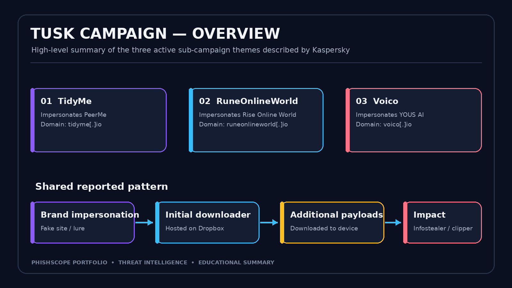
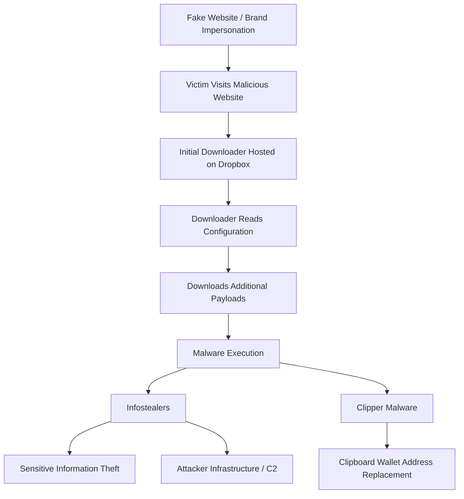
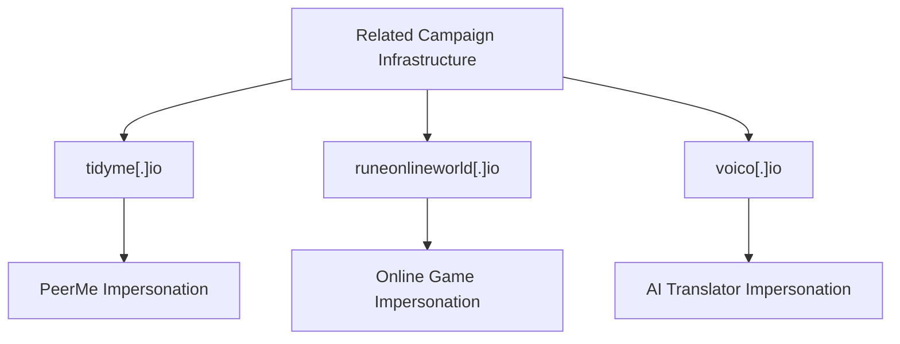

# 🛡️ Tusk Infostealer — Threat Intelligence Investigation

**Platform:** CyberDefenders  
**Category:** Threat Intelligence  
**Difficulty:** Easy  
**Focus:** Malware Analysis · OSINT · IOC Extraction · Campaign Correlation

---

## 📌 Table of Contents

- [1. Executive Summary](#1-executive-summary)
- [2. Campaign Timeline](#2-campaign-timeline)
- [3. Attack Chain](#3-attack-chain)
- [4. Campaign Analysis](#4-campaign-analysis)
  - [4.1 TidyMe — PeerMe Impersonation](#41-tidyme--peerme-impersonation)
  - [4.2 RuneOnlineWorld — Game Impersonation](#42-runeonlineworld--game-impersonation)
  - [4.3 Voico — YOUS Impersonation](#43-voico--yous-impersonation)
- [5. Downloader Technical Analysis](#5-downloader-technical-analysis)
- [6. Malware Behavior](#6-malware-behavior)
- [7. Indicators of Compromise](#7-indicators-of-compromise-iocs)
- [8. CyberDefenders Lab Answers](#8-cyberdefenders-lab-answers)
- [9. Investigation Methodology](#9-investigation-methodology)
- [10. Key Findings and Lessons Learned](#10-key-findings-and-lessons-learned)
- [11. References](#11-references)

---

## 1. Executive Summary

The **Tusk** campaign is a multi-stage cybercriminal operation documented by Kaspersky. The operators impersonated legitimate online projects to trick users into downloading malicious software or interacting with fraudulent services.

The investigated campaigns used different themes, including cryptocurrency-related services, an online game, and an AI translation platform. Despite the different themes, the campaigns shared similarities in their malware delivery techniques and infrastructure.

According to Kaspersky, the active sub-campaigns used Dropbox to host initial downloaders. Additional payloads associated with the campaign included infostealers such as **StealC** and **Danabot**, as well as cryptocurrency clipper malware.

The investigation demonstrates how threat intelligence reporting can connect suspicious domains, downloader behavior, malware families, network infrastructure, and cryptocurrency-related indicators.

**Primary source:** [Kaspersky Securelist — Tusk: Unraveling a Complex Infostealer Campaign](https://securelist.com/tusk-infostealers-campaign/113367/)

---

## 2. Campaign Timeline

The report describes multiple related sub-campaigns using different impersonation themes. The timeline below is a high-level summary of the campaign structure, not an exact chronological reconstruction of every event.

*Campaign overview image. Use a screenshot or figure from the original report if presenting this as source evidence.*

### Campaign themes

| Theme | Impersonated project | Malicious domain |
|---|---|---|
| DAO / cryptocurrency-related project | PeerMe | `tidyme[.]io` |
| Online game | Rise Online World | `runeonlineworld[.]io` |
| AI translation | YOUS | `voico[.]io` |

The campaigns used recognizable products and services to make malicious downloads appear legitimate.

---

## 3. Attack Chain

The following diagram summarizes the general infection flow described in the report.

*This is a high-level representation of the reported activity. Not every sub-campaign necessarily used every component in exactly the same way.*

### Downloader Execution Flow

*Illustration of the downloader's role in retrieving and extracting additional payloads. Replace this image with a verified screenshot or diagram if it is intended to represent direct evidence from the report.*

### Key observations

- Malicious websites imitated legitimate projects.
- Dropbox was used to host initial downloaders in the active sub-campaigns described by Kaspersky.
- Configuration files contained encoded URLs and archive-related information.
- Downloaders retrieved additional files.
- Payloads associated with the campaign included infostealers and clipper malware.

---

## 4. Campaign Analysis

### 4.1 TidyMe — PeerMe Impersonation

The first investigated sub-campaign impersonated **PeerMe**, a legitimate project associated with decentralized organizations and the MultiversX ecosystem.

| Attribute | Value |
|---|---|
| Legitimate project | PeerMe |
| Legitimate domain | `peerme.io` |
| Malicious domain | `tidyme[.]io` |
| Initial downloader | `TidyMe.exe` |
| Delivery service | Dropbox |

The malicious website used a similar project identity to make the download appear trustworthy.

This technique is known as **brand impersonation**. Attackers abuse the reputation of a real project to reduce suspicion and increase the likelihood that a victim will download and execute a file.

#### Website comparison

*Use verified screenshots from the original Kaspersky report for a direct comparison between the malicious website and the legitimate project.*

#### Technical observations

The TidyMe downloader was an Electron application. Kaspersky described a user-facing interface and background activity associated with downloading additional files.

The report also discussed a `config.json` file containing encoded URLs and archive-related configuration.

The password documented for extracting the archive was:

`newfile2024`

The function `downloadAndExtractArchive` was identified as retrieving the `archive` field.

These details help explain how the initial downloader retrieved additional components.

---

### 4.2 RuneOnlineWorld — Online Game Impersonation

The second sub-campaign impersonated **Rise Online World**, an online game.

| Attribute | Value |
|---|---|
| Legitimate project | Rise Online World |
| Legitimate domain | `riseonlineworld.com` |
| Malicious domain | `runeonlineworld[.]io` |
| Initial downloader | `RuneOnlineWorld.exe` |
| Delivery service | Dropbox |

The malicious website presented a download that appeared to be associated with the game.

The report describes a login-like interface and credential-related activity associated with this sub-campaign.

This demonstrates how attackers can adapt their social-engineering themes to different audiences while retaining similarities in their malware distribution approach.

**Analyst takeaway:** A game launcher or software installer should not be considered trustworthy simply because it uses familiar branding. The source domain, file provenance, signature, and execution behavior should be assessed.

---

### 4.3 Voico — YOUS Impersonation

The third sub-campaign impersonated **YOUS**, an AI translation service.

| Attribute | Value |
|---|---|
| Legitimate project | YOUS |
| Legitimate domain | `yous.ai` |
| Malicious domain | `voico[.]io` |
| Initial downloader | `Voico.exe` |

The malicious site used the theme of an AI translation service to make the download appear useful and legitimate.

This sub-campaign demonstrates that attackers can change the branding and intended audience while maintaining similarities in their overall distribution strategy.

### Campaign correlation

The relationship between the sub-campaigns should be assessed using the infrastructure and behavioral evidence documented in the original report. Shared infrastructure can support correlation, but it does not independently establish the identity of the operator.

---

## 5. Downloader Technical Analysis

### 5.1 Configuration file

The report discusses a `config.json` file used by the downloader.

The configuration contained encoded URLs and archive-related information. These values helped the downloader locate additional files.

| Element | Reported role |
|---|---|
| `archive` | Field containing the archive URL |
| `password` | Archive extraction password |
| `bytes` | Field associated with another encoded URL |
| `downloadAndExtractArchive` | Function that retrieves the `archive` field |
| `loadFile` | Additional download-related function discussed in the report |

### 5.2 Base64 encoding

Base64 is a method of representing binary or textual data using a limited character set.

It is important to distinguish encoding from encryption:

- **Encoding** changes how data is represented.
- **Encryption** protects data using a cryptographic process and key.

Base64-encoded URLs can make configuration values less immediately readable, but Base64 itself does not provide cryptographic secrecy.

### 5.3 Archive extraction

The password documented in the report was:

`newfile2024`

The archive extraction process is important because the initial downloader may not contain all the components used during the later stages of an infection.

**Defensive analysis note:** Malware samples should be handled in an isolated analysis environment. Avoid running unknown executables on a normal workstation or visiting malicious URLs directly.

---

## 6. Malware Behavior

### Infostealers

Infostealers are malware families designed to collect sensitive information from compromised systems. The Tusk reporting associated the campaign with malware including StealC and Danabot.

Depending on the specific malware and configuration, stolen information may include browser data, credentials, system information, and other sensitive application data.

### Clipper malware

Clipper malware can monitor clipboard activity and replace copied cryptocurrency wallet addresses.

For example, a victim may copy a legitimate recipient's wallet address, but malware may replace it with an attacker-controlled address before the transaction is submitted.

### Command and Control (C2)

Command and Control infrastructure is used by some malware to communicate with an operator or supporting systems.

The purpose of an IP address must be established from its context. A server that hosts a downloader is not necessarily a C2 server, and an IP associated with one payload should not automatically be assigned the same role for another payload.

---

## 7. Indicators of Compromise (IOCs)

The indicators below summarize selected values documented in the report and investigated during the lab. Domains and IP addresses are defanged to reduce accidental navigation.

### 7.1 Domain indicators

| Indicator | Context |
|---|---|
| `tidyme[.]io` | PeerMe impersonation |
| `runeonlineworld[.]io` | Rise Online World impersonation |
| `voico[.]io` | YOUS impersonation |

### 7.2 Network indicators

| Indicator | Context |
|---|---|
| `46.8.238[.]240` | StealC C2 |
| `23.94.225[.]177` | StealC C2 |
| `77.91.77[.]200` | Associated with downloading `madHcCtrl` files; not identified here as a StealC C2 address |

### 7.3 File and behavioral indicators

| Indicator | Context |
|---|---|
| `TidyMe.exe` | Initial downloader associated with the TidyMe sub-campaign |
| `RuneOnlineWorld.exe` | Initial downloader associated with the game-themed sub-campaign |
| `Voico.exe` | Initial downloader associated with the YOUS impersonation |
| `config.json` | Downloader configuration file |
| `downloadAndExtractArchive` | Archive URL retrieval and extraction routine |
| `loadFile` | Additional download-related function |
| `newfile2024` | Archive password documented in the report |

### 7.4 File hash

| Indicator | Value |
|---|---|
| Initial sample MD5 | `E5B8B2CF5B244500B22B665C87C11767` |

The hash above is the value used for the lab's initial sample. It should not be assumed to identify every payload associated with the campaign.

### 7.5 Cryptocurrency indicator

The following Ethereum wallet address was identified in the lab investigation:

`0xaf0362e215Ff4e004F30e785e822F7E20b99723A`

The report associated this address with clipper-related activity.

A wallet address is an investigative lead; it does not independently establish the real-world identity of its controller.

> **Operational caution:** Validate indicators against current intelligence and local telemetry before using them for blocking or incident attribution. Infrastructure can change ownership or become inactive.

---

## 8. CyberDefenders Lab Answers

The following answers were derived from the lab investigation and the referenced Kaspersky report.

| Question | Finding |
|---|---|
| Q1 — Initial file MD5 | `E5B8B2CF5B244500B22B665C87C11767` |
| Q2 — Word used to refer to victims | `Mammoth` |
| Q3 — Malicious PeerMe imitation | `tidyme.io` |
| Q4 — File-hosting service | `Dropbox` |
| Q5 — Archive password | `newfile2024` |
| Q6 — Function retrieving the `archive` field | `downloadAndExtractArchive` |
| Q7 — Legitimate AI translator and its impersonation | `YOUS (yous.ai)` / `voico.io` |
| Q8 — StealC C2 IP addresses | `46.8.238.240`, `23.94.225.177` |
| Q9 — Ethereum wallet address | `0xaf0362e215Ff4e004F30e785e822F7E20b99723A` |

**Note:** The MD5 in Q1 identifies the lab's initial sample, not necessarily every executable described in the report.

---

## 9. Investigation Methodology

The investigation followed a threat-intelligence workflow:

1. **Start with the sample hash.** Use the initial file hash as a pivot for finding relevant reporting and sample information.
2. **Review trusted threat intelligence.** Extract the campaign overview, malware families, distribution methods, and infrastructure details.
3. **Identify suspicious domains.** Compare impersonation domains with the legitimate projects they imitate.
4. **Inspect downloader configuration.** Record encoded URLs, archive information, and relevant function names.
5. **Separate IOCs by role.** Distinguish malicious domains, download infrastructure, C2 addresses, file hashes, and cryptocurrency indicators.
6. **Correlate related activity.** Look for multiple independent similarities rather than relying on a single indicator.
7. **Document findings and limitations.** Preserve the context and source of every indicator.

### Evidence versus assessment

| Evidence | Assessment |
|---|---|
| Malicious domains imitating legitimate projects | Brand impersonation was used as a lure |
| Similarities in campaign infrastructure | The sub-campaigns may be related |
| Encoded URLs in downloader configuration | The downloader can retrieve additional resources |
| StealC C2 addresses in the report | Potential leads for network hunting |
| Cryptocurrency wallet referenced in the report | A lead for further blockchain analysis |

Assessments should remain proportional to the evidence. Correlation is not the same as proof of attribution.

---

## 10. Key Findings and Lessons Learned

- **Brand impersonation is an effective social-engineering technique.** A polished website does not establish legitimacy.
- **Legitimate hosting services can be abused.** A file hosted on a trusted platform still requires validation.
- **Downloaders and final payloads have different roles.** Investigators should examine the full infection chain.
- **IOC context matters.** Download infrastructure, C2 servers, and cryptocurrency indicators must not be treated as interchangeable.
- **Infrastructure correlation supports investigation.** Shared infrastructure and behavior can connect activity across sub-campaigns.
- **Attribution requires caution.** Technical indicators alone do not prove an operator's identity.
- **Documentation is part of the investigation.** Findings should be reproducible and traceable to reliable sources.

### Skills practiced

- Threat Intelligence
- Open-Source Intelligence (OSINT)
- IOC Extraction
- Malware Campaign Analysis
- Infrastructure Correlation
- Defensive Investigation and Technical Reporting

---

## 11. References

1. **Kaspersky Securelist:** [Tusk: Unraveling a Complex Infostealer Campaign](https://securelist.com/tusk-infostealers-campaign/113367/)
2. **CyberDefenders:** [Tusk Infostealer Lab](https://cyberdefenders.org/blueteam-ctf-challenges/tusk-infostealer/)

---

## Conclusion

The Tusk investigation demonstrates how threat intelligence connects suspicious domains, social engineering, malware downloaders, infostealers, clipper malware, network infrastructure, and cryptocurrency-related evidence.

The most important outcome is not simply collecting IOC values. It is understanding how the evidence connects, what each indicator represents, and which conclusions are justified by the available reporting.

This investigation strengthened my understanding of malware campaign analysis, infrastructure correlation, IOC context, and evidence-based threat intelligence reporting.
